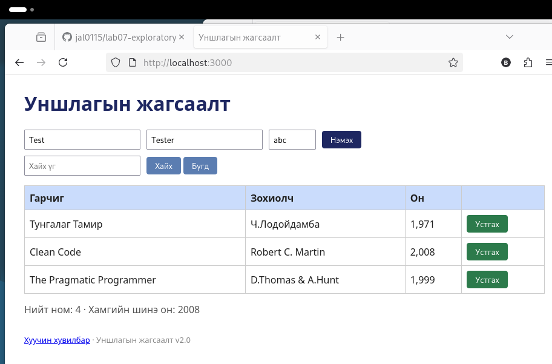

# BUG-01: «Нийт ном» тоолуур хүснэгтэд буй номын тооноос 1-ээр илүү харагдана

Орчин: Уншлагын жагсаалт v2.0, Firefox 140.15.0esr, Debian GNU/Linux, 2026-10-19
Урьдчилсан нөхцөл: node app.js-ийг шинээр асаасан (анхны 3 ном)

## Дахин гаргах алхам
1. Терминалд `node app.js`-ийг шинээр асаа.
2. Firefox-оор http://localhost:3000 нээ.
3. Хүснэгтийн мөрийг тоолоод хуудасны доорх «Нийт ном: ...» мөртэй харьцуул.

Хүлээгдэж байсан: Спецификаци: «`Нийт ном` тоолуур хүснэгтэд буй номын тоотой тэнцүү.» Хүснэгтэд 3 ном байгаа тул «Нийт ном: 3».

Бодит үр дүн: Хүснэгтэд 3 ном, гэвч «Нийт ном: 4» гэж харагдана.

Ноцтой байдал: Minor. Өгөгдөл алдагдахгүй ч хэрэглэгчид буруу тоо харуулна.

Хавсралт: 

Олдсон аялал: Supermodel (GUI)
