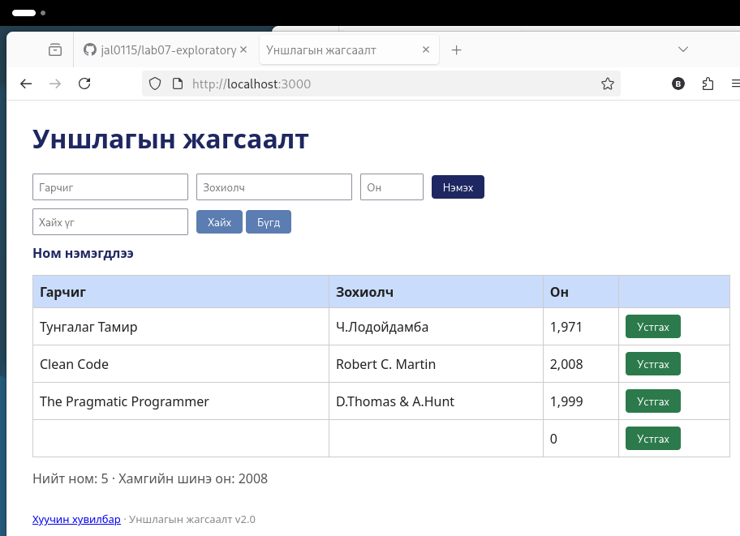

# BUG-02: Гурван талбар хоосон байхад ном нэмэгдэж, хоосон мөр үүснэ

Орчин: Уншлагын жагсаалт v2.0, Firefox 140.15.0esr, Debian GNU/Linux, 2026-10-19
Урьдчилсан нөхцөл: node app.js-ийг шинээр асаасан (анхны 3 ном)

## Дахин гаргах алхам
1. Апп-ыг шинээр асаагаад http://localhost:3000 нээ.
2. Гарчиг, Зохиолч, Он талбаруудыг хоосон орхи.
3. «Нэмэх» товчийг дар.

Хүлээгдэж байсан: Спецификаци: «Ном нэмэхэд Гарчиг, Зохиолч, Он гурван талбар бүгд заавал бөглөгдсөн байх ёстой; дутуу бол ном нэмэгдэхгүй, ойлгомжтой алдааны мессеж харагдана.»

Бодит үр дүн: «Ном нэмэгдлээ» мессеж гарч, хүснэгтэд хоосон гарчиг, хоосон зохиолч, он `0` гэсэн шинэ мөр нэмэгдэнэ. «Нийт ном: 5».

Ноцтой байдал: Major. Хоосон, утгагүй өгөгдөл хадгалагдана.

Хавсралт: 

Олдсон аялал: Couch Potato (хоосон оролт)
