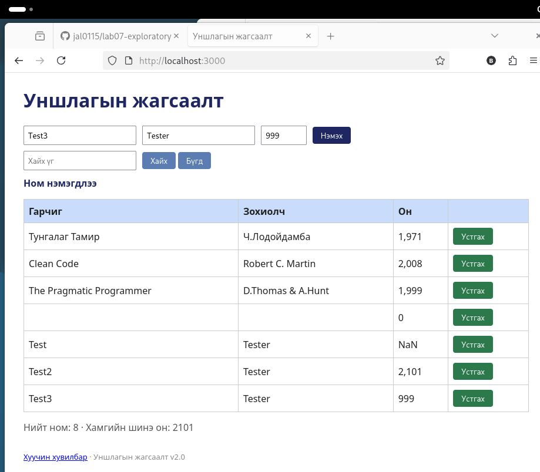

# BUG-03: Оны шалгалт байхгүй: `abc`, `2101`, `999` хүлээн авагдана

Орчин: Уншлагын жагсаалт v2.0, Firefox 140.15.0esr, Debian GNU/Linux, 2026-10-19
Урьдчилсан нөхцөл: node app.js-ийг шинээр асаасан (анхны 3 ном)

## Дахин гаргах алхам
1. Апп-ыг шинээр асаагаад http://localhost:3000 нээ.
2. Гарчиг=`Test`, Зохиолч=`Tester`, Он=`abc` гэж нэмж «Нэмэх» дар.
3. Гарчиг=`Test2`, Зохиолч=`Tester`, Он=`2101` гэж нэм.
4. Гарчиг=`Test3`, Зохиолч=`Tester`, Он=`999` гэж нэм.

Хүлээгдэж байсан: Спецификаци: «Он нь 1000-2100 хоорондох бүхэл тоо.» Эдгээр гурван утга хүлээн авагдах ёсгүй, алдааны мессеж гарах ёстой.

Бодит үр дүн: Гурвуулаа «Ном нэмэгдлээ» мессежтэй нэмэгдэнэ. Хүснэгтэд он нь `NaN`, `2,101`, `999` гэж харагдана.

Ноцтой байдал: Major. Буруу өгөгдөл хадгалагдаж, `NaN` харагдана.

Хавсралт: 

Олдсон аялал: Couch Potato (хязгаарын утга)
