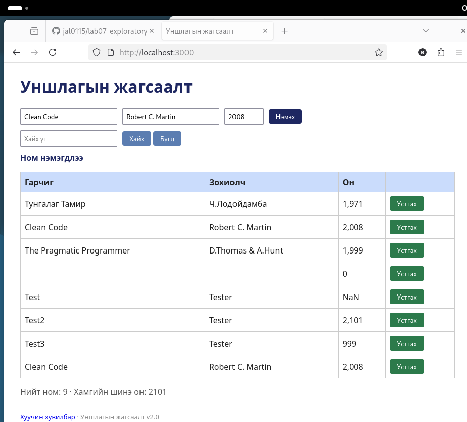

# BUG-04: Ижил гарчиг, зохиолчтой ном давхардан нэмэгдэнэ

Орчин: Уншлагын жагсаалт v2.0, Firefox 140.15.0esr, Debian GNU/Linux, 2026-10-19
Урьдчилсан нөхцөл: node app.js-ийг шинээр асаасан (анхны 3 ном)

## Дахин гаргах алхам
1. Апп-ыг шинээр асаагаад http://localhost:3000 нээ.
2. Гарчиг=`Clean Code`, Зохиолч=`Robert C. Martin`, Он=`2008` гэж бич (хүснэгтэд аль хэдийн байгаа ном).
3. «Нэмэх» дар.

Хүлээгдэж байсан: Спецификаци: «Ижил гарчиг, зохиолчтой ном давхардуулж нэмэгдэхгүй.»

Бодит үр дүн: «Ном нэмэгдлээ» мессеж гарч, хүснэгтэд `Clean Code` хоёр мөр болно. «Нийт ном: 5».

Ноцтой байдал: Major. Өгөгдөл давхардана.

Хавсралт: 

Олдсон аялал: Couch Potato
