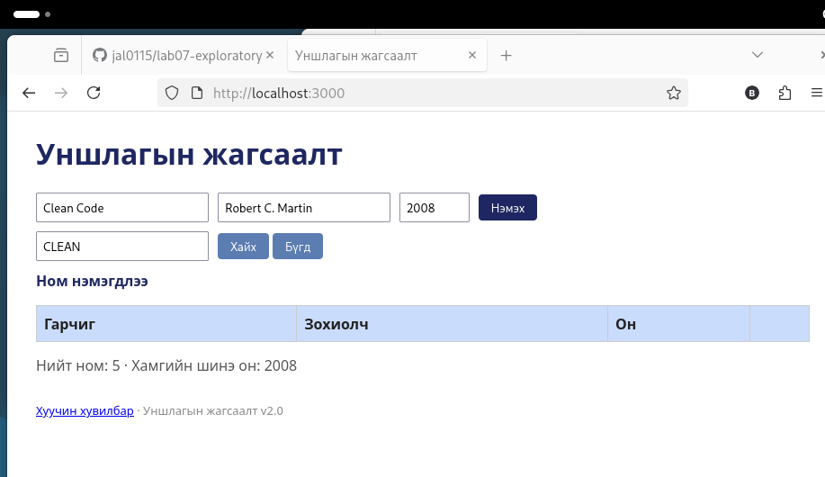

# BUG-05: Хайлт том/жижиг үсгийг ялгадаг

Орчин: Уншлагын жагсаалт v2.0, Firefox 140.15.0esr, Debian GNU/Linux, 2026-10-19
Урьдчилсан нөхцөл: node app.js-ийг шинээр асаасан (анхны 3 ном)

## Дахин гаргах алхам
1. Апп-ыг шинээр асаагаад http://localhost:3000 нээ.
2. «Хайх үг» талбарт `Clean` бичээд «Хайх» дар, үр дүнг хар.
3. Дараа нь `clean`, дараа нь `CLEAN` хайж үз.

Хүлээгдэж байсан: Спецификаци: «Хайлт гарчиг болон зохиолчоос хайх ба том/жижиг үсэг ЯЛГАХГҮЙ.» Гурван хайлт ижил үр дүн (`Clean Code`) өгөх ёстой.

Бодит үр дүн: `Clean` → `Clean Code` 1 мөр. `clean` ба `CLEAN` → хоосон хүснэгт.

Ноцтой байдал: Major. Хэрэглэгч үсгийн хэлбэрээс шалтгаалж ном олдохгүй.

Хавсралт: 

Олдсон аялал: Supermodel (GUI)
