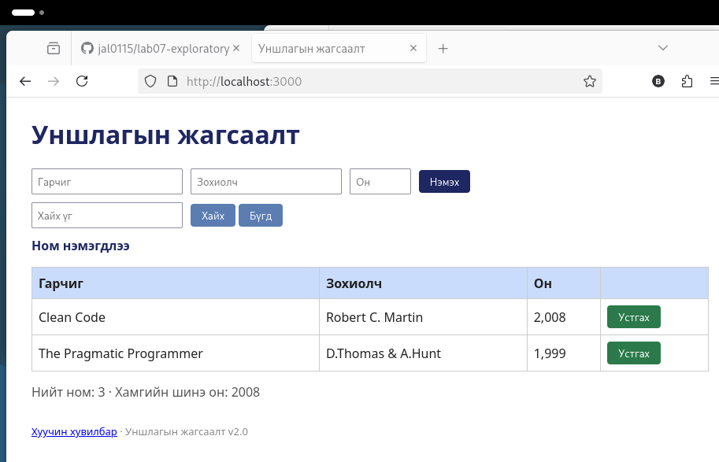

# BUG-06: Ном устгасны дараа «Ном нэмэгдлээ» гэсэн буруу мессеж гарна

Орчин: Уншлагын жагсаалт v2.0, Firefox 140.15.0esr, Debian GNU/Linux, 2026-10-19
Урьдчилсан нөхцөл: node app.js-ийг шинээр асаасан (анхны 3 ном)

## Дахин гаргах алхам
1. Апп-ыг шинээр асаагаад http://localhost:3000 нээ.
2. Эхний мөр (Тунгалаг Тамир)-ийн «Устгах» товчийг дар.
3. Хуудасны мессежийг хар.

Хүлээгдэж байсан: Спецификаци: «Үйлдэл бүрийн дараах мессеж тухайн үйлдэлдээ тохирно.» Устгасны дараа устгахтай холбоотой мессеж гарах ёстой.

Бодит үр дүн: Ном устсан ч «Ном нэмэгдлээ» мессеж гарна (хүснэгтэд 2 мөр үлдэнэ).

Ноцтой байдал: Minor. Үйлдэл амжилттай ч мессеж төөрөгдүүлнэ.

Хавсралт: 

Олдсон аялал: Supermodel (GUI)
