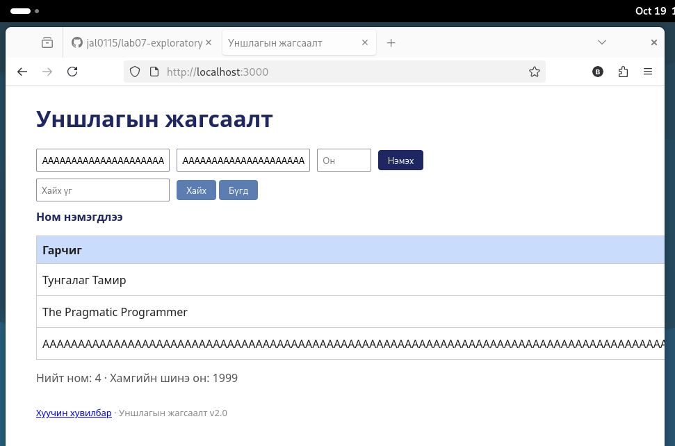

# BUG-07: Хэт урт оролтод хуудас хэвтээ тийш хэтэрч, хүснэгт эвдэрнэ

Орчин: Уншлагын жагсаалт v2.0, Firefox 140.15.0esr, Debian GNU/Linux, 2026-10-19
Урьдчилсан нөхцөл: node app.js-ийг шинээр асаасан (анхны 3 ном)

## Дахин гаргах алхам
1. Апп-ыг шинээр асаагаад http://localhost:3000 нээ.
2. Терминалд `python3 -c "print('A'*300)"` ба `python3 -c "print('B'*200)"` ажиллуулж гаралтыг хуул.
3. Гарчигт 300 `A`, Зохиолчид 200 `B`, Он=`2020` бич.
4. «Нэмэх» дар.

Хүлээгдэж байсан: Спецификаци: «Хүснэгт ямар ч урттай оролтод эвдрэхгүй.»

Бодит үр дүн: Гарчиг хүснэгтийн баганаас хэтэрч, хуудас хэвтээ тийш гүйдэг болно. «Он» ба «Устгах» баганууд дэлгэцээс гадуур үлдэнэ.

Ноцтой байдал: Major. Шинэ мөрийн «Устгах» товч харагдахгүй болно.

Хавсралт: 

Олдсон аялал: Couch Potato (хэт урт оролт)
