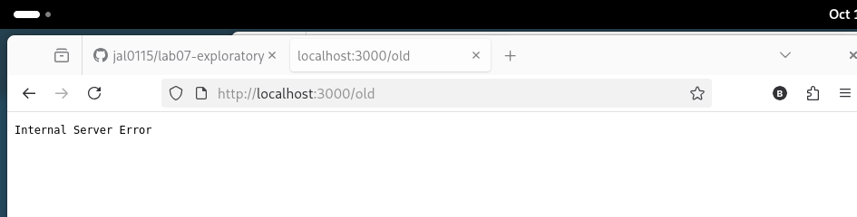

# BUG-08: «Хуучин хувилбар» линк «Internal Server Error» өгнө

Орчин: Уншлагын жагсаалт v2.0, Firefox 140.15.0esr, Debian GNU/Linux, 2026-10-19
Урьдчилсан нөхцөл: node app.js-ийг шинээр асаасан (анхны 3 ном)

## Дахин гаргах алхам
1. Апп-ыг шинээр асаагаад http://localhost:3000 нээ.
2. Хуудасны доод хэсгийн «Хуучин хувилбар» линкийг дар.

Хүлээгдэж байсан: Спецификаци: «Бүх хуудас, линк ажиллана.»

Бодит үр дүн: `http://localhost:3000/old` нээгдэж, зөвхөн «Internal Server Error» текст гарна.

Ноцтой байдал: Major. Хуудсан дээрх линк эвдэрсэн.

Хавсралт: 

Олдсон аялал: Supermodel (линк шалгалт)
