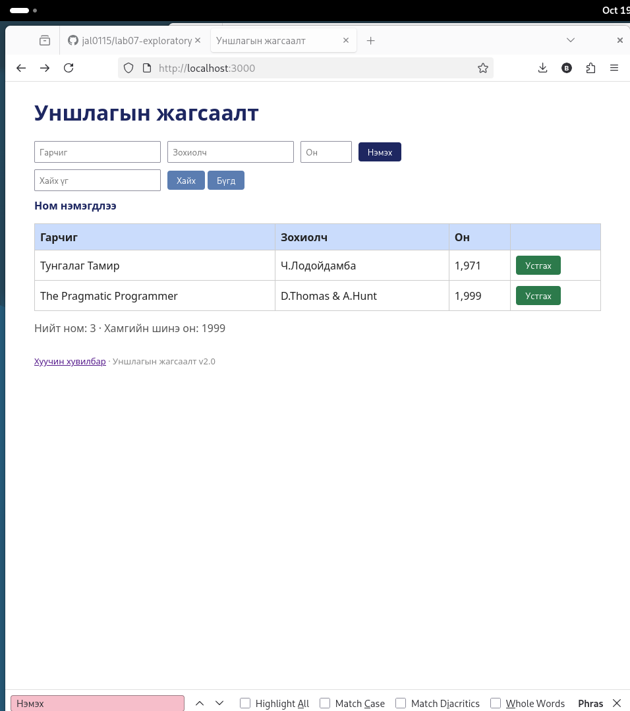

# BUG-11: «Нэмэх» товчны текстэд Кирилл `х`-ийн оронд Латин `x` байна

Орчин: Уншлагын жагсаалт v2.0, Firefox 140.15.0esr, Debian GNU/Linux, 2026-10-19
Урьдчилсан нөхцөл: node app.js-ийг шинээр асаасан (анхны 3 ном)

## Дахин гаргах алхам
1. Апп-ыг шинээр асаагаад http://localhost:3000 нээ.
2. `Ctrl+F` дарж Кирилл гараар `Нэмэх` гэж хай.
3. Хайлтын мөрийн өнгөнд анхаар.

Хүлээгдэж байсан: Спецификаци: «Текстүүд үсгийн алдаагүй.» Хайлт товч дээр таарах ёстой.

Бодит үр дүн: Firefox «Phrase not found» гэнэ. Товч нүдэнд «Нэмэх» гэж харагдах ч сүүлийн үсэг Латин `x`.

Ноцтой байдал: Cosmetic. Нүдэнд ялгагдахгүй, хайлт/текстийн ойлгомжид нөлөөлнө.

Хавсралт: 

Олдсон аялал: Supermodel (GUI, текст шалгалт)
