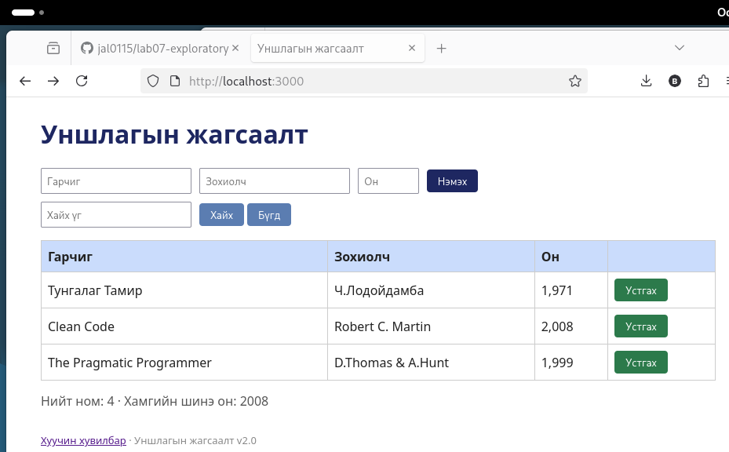

# BUG-12: «Устгах» товч ногоон өнгөтэй, улаан биш

Орчин: Уншлагын жагсаалт v2.0, Firefox 140.15.0esr, Debian GNU/Linux, 2026-10-19
Урьдчилсан нөхцөл: node app.js-ийг шинээр асаасан (анхны 3 ном)

## Дахин гаргах алхам
1. Апп-ыг шинээр асаагаад http://localhost:3000 нээ.
2. Хүснэгтийн баруун баганын «Устгах» товчнуудын өнгийг хар.

Хүлээгдэж байсан: Спецификаци: «Аюултай үйлдлийн товч (Устгах) улаан өнгөтэй.»

Бодит үр дүн: «Устгах» товчнууд ногоон өнгөтэй.

Ноцтой байдал: Minor. Өгөгдөл устгах үйлдлийг ногоон гэж харуулах нь хэрэглэгчийг төөрөгдүүлнэ.

Хавсралт: 

Олдсон аялал: Supermodel (GUI)
